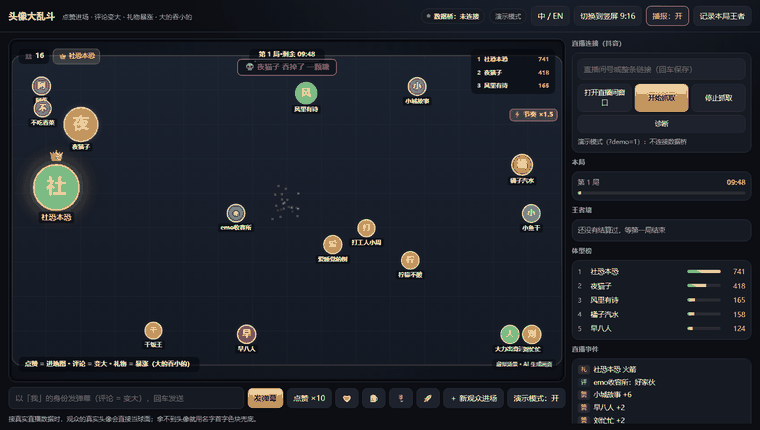
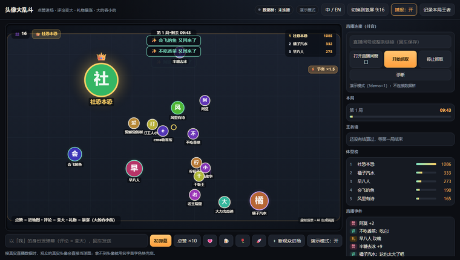
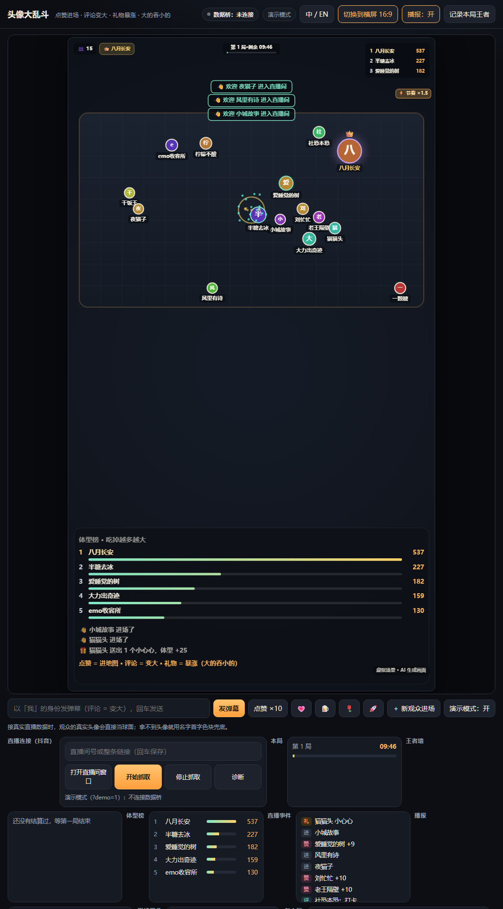
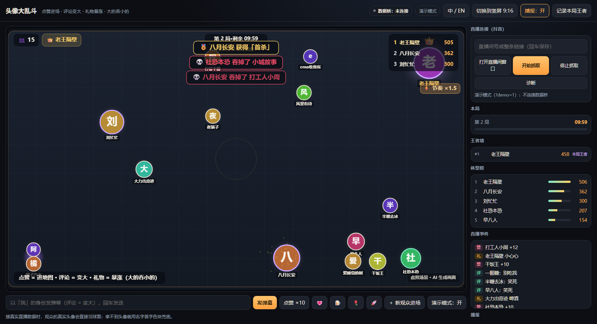

# 头像大乱斗 · Avatar Arena

**直播间里的头像大乱斗**：观众点赞就进场、评论就变大、送礼就暴涨，头像们在地图里互相追逐，**大的吞掉小的并变大**。
免费也能玩，礼物只是"更快更炫"；每 10 分钟结算一局，出王者、巨物、首杀、连吃王、复仇成功，并写进**王者墙**。

> 一个可以无人值守跑起来的互动直播玩法：没有真人主播出镜，画面自己就有戏。
> 中文 · [English](#english) · [玩法设计](docs/方案-头像大乱斗.md) · [更新日志](CHANGELOG.md)



<p align="center">
  
  
  
  
  
</p>

---

## 这是什么

直播间的观众不再只是"看"：**点赞就能把自己的真实头像送进地图**，之后每一条弹幕、每一个赞、每一份礼物都会让它变大；地图里所有头像都在乱跑，同级相碰弹开，体型差够大就能把对方吞掉。被吃掉不是结束——再互动一次就复活。

- 🎮 **零学习成本**：规则一句话说完，连麦都不用开
- 🖼️ **真实头像**：球面就是观众的头像，认脸即认人
- 🔥 **越热闹越快**：直播间互动越多，全场节奏自动加速（有上限，停手回落）
- 🏆 **有局有榜**：10 分钟一局结算，称号 + 王者墙，第二天回来还能看到自己的位置
- 🛠️ **可以现场调**：速度、吃获率、衰减、追逃智能、人数上限全部滑杆实时生效
- 📱 **竖屏直出**：9:16 构图，OBS 窗口采集就能开播
- 🌐 **中英双语**：右上角一键切换，TikTok 场景直接用

## 快速开始

开箱即用，**不需要再下载别的项目**——抖音数据桥已经内置在 `bridge/` 里了。

| 依赖 | 是否必需 | 说明 |
|---|---|---|
| **Python 3.9+** | 必需 | 启动本地服务和桌面窗口 |
| **pywebview** | 桌面窗口需要 | `pip install pywebview`；纯浏览器预览不用 |
| **Node.js 18+** | 接真实弹幕需要 | 跑内置数据桥；只玩演示模式不用 |
| WebView2 Runtime | Windows 桌面窗口需要 | Win10/11 一般自带 |

```bash
pip install pywebview     # 只有用桌面窗口才需要；纯浏览器预览可以跳过
```

```bat
:: 双击运行（会打开桌面窗口）
start.bat              :: 横屏
start-portrait.bat     :: 竖屏 9:16（OBS 采集用）
```

不想开桌面窗口？也可以纯浏览器预览：

```bash
python -m http.server 8090
# 打开 http://127.0.0.1:8090/index.html?demo=1
```

`?demo=1` = 强制演示模式：不连接任何数据桥，本地自动生成模拟观众，适合先看效果、录屏、截图。

### 界面

| 横屏（带控制面板） | 竖屏（直播画面） |
|---|---|
|  |  |

一局结束会自动结算并写进王者墙：



## 玩法规则

| 操作 | 效果 |
|---|---|
| **点赞** | 第一个赞把你送进地图，之后的赞让你变大 |
| **评论** | 稍微变大（每人 1.5 秒一次，防刷） |
| **礼物** | 暴涨：💗 +25 / 🍺 +45 / 🍬 +65 / 🌹 +95 / 🚀 +220 |
| **吃** | 体型差 ≥15% 就能吞掉对方，吸收对方 62% 的质量 |
| **同级** | 相碰弹开，不会互相伤害 |
| **撞墙** | 法向弹开 + 切向滑行，角落会自动散开（不会堆在边角） |
| **防滚雪球** | 大号每秒衰减 + 质量上限 + 越大越慢 → 王者会被追平；衰减会**一路压到 200**（不会停在 300） |
| **被吃了** | 随便再互动一次就复活（2.5 秒冷却），死亡只是节目效果 |
| **清屏** | 底部「🧹 清屏」一键移除地图上所有头像（换场、画面太乱时用；之后新互动照常进场） |

### 现场调参（改完立即生效，自动保存）

| 参数 | 默认 | 作用 |
|---|---|---|
| 基础移动速度 | 118 | 40–260。慢=耐看、好躲；快=刺激、更乱 |
| 互动加速 | 0.9 | 0 = 关闭；0.9 = 最热闹时全场最多 ×1.9 |
| 吃掉吸收率 | 0.62 | 越小越防滚雪球 |
| 大号衰减 | 0.004 | 越大缩得越快，王者换人更快 |
| 衰减下限 | 2.0 | ×100 = **200**。大号会一路压到这个体型（可调 100–250） |
| 追逃智能 | 0.65 | 0 = 纯随机漂移；1 = 强烈追逃 |
| 同时在线上限 | 60 | 地图里最多多少个头像 |
| 一局时长 | 10 分钟 | 到点结算王者/称号 |

> 想让画面更"躁"：速度 150–180 + 互动加速 1.2；想耐看、让小的更容易逃命：速度 90–110 + 互动加速 0.5。

## 接入真实抖音弹幕

**数据桥已内置**（`bridge/`，Node.js，零 npm 依赖），只需要 Node.js 18+，不用再下载别的项目。页面右上「直播连接（抖音）」面板里就是完整链路：

1. 填**直播间号或整条链接**（如 `123456789`），回车保存；
2. 点 **「打开直播间窗口」** —— 用 Edge/Chrome 开一个带远程调试端口的直播窗口，扫码登录抖音；
3. 点 **「开始抓取」** —— 启动 `bridge/douyin-bridge.mjs`，页面自动连上 `ws://127.0.0.1:8765`，真实昵称/头像/点赞/评论/礼物就进来了。

**关于内置的 bridge/**

| | |
|---|---|
| 来源 | 开源项目「头像打印机」[rhfbgfgfdg999999/3d-printer-live](https://github.com/rhfbgfgfdg999999/3d-printer-live)（作者 VESAM9J / 志哥AI，213★，[B 站教程](https://www.bilibili.com/video/BV1WJxx61EUf/)） |
| 许可 | **MIT**，版权归原作者，见 [bridge/LICENSE](bridge/LICENSE)；本仓库**原样内置、未修改** |
| 版本 | 上游 commit `c3a21d4`（2026-11-01） |
| 只含 | `douyin-bridge.mjs`（采集器）+ `bridge-ws.mjs`（内置 WS 服务），仅用 Node 内置模块 |

想换成自己的采集器：把 `ARENA_BRIDGE_DIR` 指向该目录即可（优先级最高）。想更新上游新版：见 [bridge/README.md](bridge/README.md)。

**接了但没反应？** 点页面上的 **「诊断」**：它会显示数据桥状态、直播间窗口里的标签页 URL、采集器进程、以及采集器日志最后几行（日志在 `bridge/desktop-bridge.log`）。常见原因见 [FAQ](#faq)。

> ⚠️ 商用/上平台请走抖音「直播小玩法」官方通道（提案 → 审核 → exe 挂直播伴侣 → 官方数据推送）。本仓库的抓取链路只适合自己直播间自播测试。

## 技术架构

纯前端 Canvas 2D + 一个很小的 Python 启动器，没有构建步骤、没有 npm 依赖、没有后端服务。

```
直播间 (抖音)
   │  弹幕/点赞/礼物
   ▼
数据桥 bridge/（内置，可替换）──WebSocket(8765)──►  arena-bridge.mjs   事件接入 + 本地演示模拟器
                                                │
                                                ▼
                                        arena-engine.mjs        纯逻辑：规则 / 物理 / 衰减 / 复活
                                          │        │
                        arena-rounds.mjs ─┘        └─► arena-render.mjs    Canvas 渲染（横屏/竖屏）
                        （局 / 称号 / 王者墙）          arena-speech.mjs    TTS 播报
                                                         │
                                                index.html ──► launch.py（本地服务 + WebView2 窗口）
```

| 文件 | 作用 |
|---|---|
| `index.html` | 页面：地图、局倒计时、王者墙、体型榜、事件流、现场调参、中/EN |
| `arena-engine.mjs` | 规则与物理（进场、变大、吞并、衰减、复活、贴墙反弹、节奏） |
| `arena-rounds.mjs` | 局 / 称号 / 王者墙（localStorage） |
| `arena-settings.mjs` | 参数默认值 + 越界校验 + 调参面板 |
| `arena-render.mjs` | Canvas 渲染，画面自带全部直播信息（可单独给 OBS 采集） |
| `arena-speech.mjs` | 欢迎 / 王者 / 称号播报（浏览器 TTS） |
| `arena-i18n.mjs` | 中英文案一张表（不复制第二份 HTML） |
| `arena-bridge.mjs` | WebSocket 接入 + 数据桥探测 + 本地演示模拟器 |
| `bridge/` | **内置的抖音数据桥**（上游 MIT 原样内置：`douyin-bridge.mjs` + `bridge-ws.mjs`，见 [bridge/README.md](bridge/README.md)） |
| `launch.py` | 本地 HTTP 服务（钉死 MIME）+ WebView2 窗口 + 数据桥管理接口 |
| `start.bat` / `start-portrait.bat` | Windows 一键启动 |

## 为什么这样设计

几个反直觉但关键的取舍，都写成了可单测的纯逻辑：

1. **吃掉只吸收 62%，大号还会衰减**
   否则第一个变大的观众永远赢，其他人 3 分钟内就会划走。衰减 + 上限 + 越大越慢，让"王者"每 1–2 分钟换人。
2. **点赞不新开头像，而是让已有头像变大**
   抖音点赞是洪水，若每个赞都进场，60 个位置 10 秒就满、全是小号。现在的规则是"第一个赞进场，之后的赞喂自己"。
3. **互动越多，全场越快**
   最近 6 秒的互动量 → 热度 → 节奏倍率（1 ~ 1+互动加速），指数平滑过渡、停手回落；画面右上角显示「⚡ 节奏 ×1.4」。
4. **贴墙用"法向消解 + 切向保留 + 卡住自愈"**
   只写"撞墙反向"会和转向逻辑打架，结果是头像粘在角落。现在角落会自动散开（60 秒压力测试里贴墙采样占比 0.5%）。
5. **被吃了不代表出局**
   随便再互动一次就复活，死亡变成节目效果，还给了"复仇"的理由（复仇成功是称号之一）。

## 测试

```powershell
node --test "arena-*.test.mjs"     # 45 个用例：规则/吞并/衰减/清屏/复活/局结算/称号/王者墙/设置/文案/渲染/贴墙
python test_launch_windows.py      # 29 个用例：启动器/MIME/服务/内置数据桥/窗口尺寸/进程清理/诊断
```

CI 配置在 [.github/workflows/test.yml](.github/workflows/test.yml)（Windows runner，和实际运行环境一致）。

## FAQ

**Q：打开是空的/只有几个头像？**
用 `?demo=1` 预览；正常启动时如果连不上数据桥会自动进演示模式，20 秒左右地图就热闹了。

**Q：接了数据桥，页面显示"已连接"但一条弹幕都没有？**
点「诊断」看日志最后几行：
- 反复显示「独立直播窗口未就绪」→ 有个旧的采集器在 8765 空跑，先在打印项目里停止抓取或结束那个 node 进程；
- 标签页 URL 不是 `live.douyin.com/房间号` → 直播间没登录/没进直播间；
- 房间号不是正在直播的那个 → 未开播/回放没有弹幕协议帧。

**Q：关掉程序后，直播间窗口关了又自己弹出来？**
旧版本退出时没结束采集器（node）进程，它变成孤儿后找不到直播间标签页，就会自动重开窗口。现在：**关程序会自动结束采集器并关闭直播间窗口**；如果你手上是旧版本或程序被强杀，点一次「停止抓取」（会顺手清理残留采集器）或点「关闭直播间窗口」即可。

**Q：能换成我的头像/背景/美术风格吗？**
可以，渲染全在 `arena-render.mjs`：球面、描边、地形网格、配色都在这一层，改完刷新即可。

**Q：手机能看吗？**
页面本身是响应式的，竖屏就是给手机/竖屏直播设计的；桌面启动器是 Windows 的，其他系统用浏览器打开即可。

## 合规与免责

- 本仓库**不含**抖音协议抓取代码，真实弹幕链路依赖外部的开源数据桥，仅建议用于**自己的直播间**做自播测试。
- 所有平台（抖音/快手/小红书/TikTok）都禁止"无人直播、录播、假互动"。请勿用本程序伪造观众或假装实时互动；演示模式的模拟观众**只用于本地预览和录屏**，正式开播请关闭。
- 画面内已常驻「虚拟场景 · AI 生成画面」标识；每场开播请重新声明。
- 商用请走「直播小玩法」官方通道；礼物只做"更快更炫"，不涉及抽奖、盲盒、倍率或随机数值。
- 使用本程序产生的任何平台处罚、账号风险由使用者自行承担。

更多平台规则调研：[docs/research/market-notes.md](docs/research/market-notes.md)（38 个来源，含官方文档与处罚口径）。

## Roadmap

- [ ] 撞墙/吞并的视觉反馈（边角光晕、撞击小火花）
- [ ] 王者墙截图分享（一键出图）
- [ ] 更多局内事件：双倍时间、空投礼物、连吃特效
- [ ] macOS / Linux 启动器（目前靠浏览器打开）
- [ ] 官方「直播小玩法」接入示例

## 作者 / 联系

- 作者：**salmjohn**
- GitHub：[@abdusalam1](https://github.com/abdusalam1)
- 邮箱：salmjohnn@outlook.com
- 微信：扫码添加（备注「头像大乱斗」）


## 致谢

- **头像打印机**（作者 VESAM9J / 志哥AI，MIT）：[rhfbgfgfdg999999/3d-printer-live](https://github.com/rhfbgfgfdg999999/3d-printer-live) —— 抖音弹幕采集链路，已按 MIT 许可**原样内置**在 [bridge/](bridge/)（保留原作者版权声明，未修改）。也是本项目的灵感来源。[B 站教程视频](https://www.bilibili.com/video/BV1WJxx61EUf/)
- 平台规则调研里的官方文档、媒体与开源项目，见 [docs/research/market-notes.md](docs/research/market-notes.md)。

## License

本仓库代码 [MIT](LICENSE) © 2026 salmjohn。
`bridge/` 目录来自上游项目，同样为 MIT，版权归原作者 志哥AI，见 [bridge/LICENSE](bridge/LICENSE)。

---

<a id="english"></a>
## English

**Avatar Arena** — an interactive live-stream game for Douyin / TikTok LIVE. Viewers' real avatars enter the arena with a **like**, grow with **comments**, surge with **gifts**, and the **bigger avatar eats the smaller one**. Free actions always matter; gifts only make you faster/flashier. Every 10 minutes a round settles with titles (Round King, Colossus, First Blood, Feeding Frenzy, Revenge) and a hall of fame.

- Zero build step: Python launcher + plain ES modules + Canvas 2D.
- `start.bat` (landscape) / `start-portrait.bat` (9:16 for OBS) on Windows; or `python -m http.server 8090` then open `index.html?demo=1`.
- Live data: a Douyin bridge is **bundled** in `bridge/` (vendored unmodified from the MIT-licensed [Avatar Printer](https://github.com/rhfbgfgfdg999999/3d-printer-live) project, original copyright kept) — just needs Node.js 18+. Open the live room window, scan the QR code, hit “Start capture”. Set `ARENA_BRIDGE_DIR` to use a different bridge.
- Tuning sliders for speed, eat absorption, decay, chase AI, crowd hype, avatar cap and round length.
- Tests: `node --test "arena-*.test.mjs"` (41) and `python test_launch_windows.py` (20).
- Compliance: no fake interaction, no lotteries/random rewards; use the official LIVE mini-game channel for commercial streaming.

Design notes (Chinese): [docs/方案-头像大乱斗.md](docs/方案-头像大乱斗.md)
