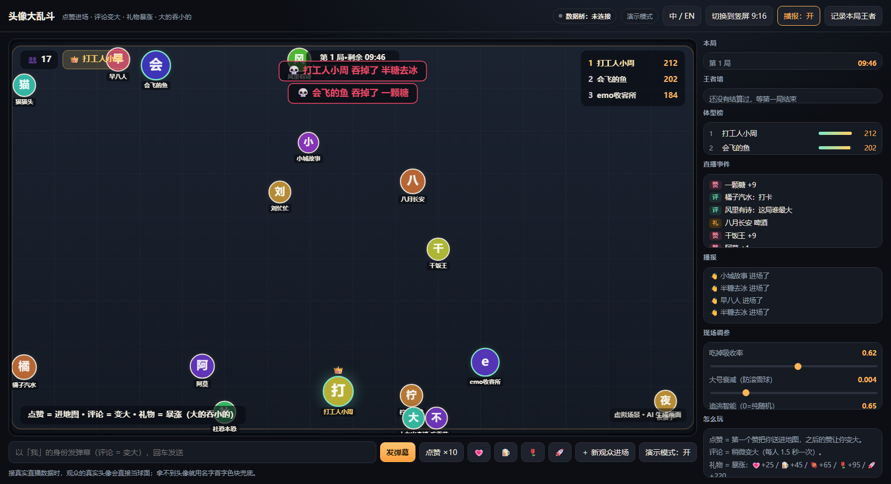
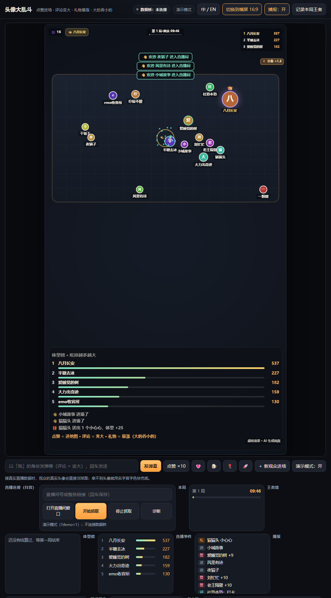
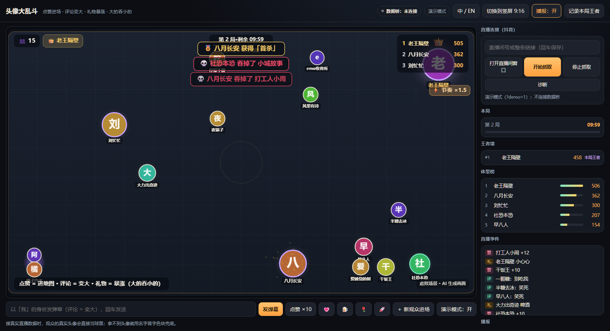

# 头像大乱斗 · 想法评估 + 可运行原型

> 你的想法（头像消消乐：进场播报 → 点赞加入 → 评论变大 → 礼物更大 → 无规则运动 → 同级弹开 → 大吃小）
> **结论：成立，而且比我上一版"头像小镇"更适合你现在的节奏。**核心机制就是 Agar.io / 球球大作战那套"大吃小"，已经被验证过；你的差异化在于**球面是观众的真实头像**，而"大"这件事本身就是身份和荣誉，天然适合礼物。
> 但有 5 个坑必须现在改，否则开播三分钟就凉。原型已经按改过的版本做出来了，可以直接跑。

---

## 1. 你这个想法为什么成立

| 你的设计 | 为什么对 | 备注 |
|---|---|---|
| 进直播间播报欢迎 | 免费行为有反馈，平台硬性要求；也是"我被看见了"的第一秒 | 用 TTS，只念欢迎不念弹幕 |
| 点赞 → 加入地图 | **免费就能玩**，这是留存的地基；点赞量大，正好当"入场券" | 抖音点赞是洪水，必须限流 |
| 评论 → 稍微变大 | 文字行为有可见后果 | 见 §4 的官方关键词限制 |
| 礼物 → 更变大 | 付费的即时满足，"大"就是屏幕上最大的荣誉 | 平台要求礼物只做"更快更炫"，不能是唯一路径 |
| 无规则运动 | 画面永远在动，不会冷场；不需要主播 | 见坑 2 |
| 同级弹开 / 大吃小 | **规则一眼就懂**（这是弹幕游戏最难得的东西），而且"吃"本身是节目效果 | 见坑 1 |

一句话：**即时爽感 + 零学习成本 + 名字头像全程可见 + 每 10 秒就有一个"事件"**。这四点就是这类玩法的全部。

---

## 2. 五个必须改的坑

### 坑 1（致命）：滚雪球——第一个变大的永远赢
原规则的数学后果：大吃小后质量相加，**强者恒强**，观众 3 分钟内就会发现"追不上"，然后划走。这是所有 agar 类玩法在直播场景的头号死因。
**改法（原型已实现，且可现场调）**：
- 吃掉只吸收 **62%**（`eatGain`），剩下的蒸发 → 全场总质量在缓慢泄漏；
- 大号每秒 **衰减**（`decayPerSec`，只在超过 3 倍基础体型后触发）；
- 质量有**上限**（26 倍）；
- **越大越慢**（速度按质量开根号衰减）→ 小的永远跑得掉。
效果：王者每 1–2 分钟换人，观众会觉得"下一把可能是我"。

### 坑 2：纯随机运动 = 一群图标在漂
"无规则运动"在代码里就是随机游走，看起来像卡顿。真实直播里需要**情绪**：
**改法**：保留随机游走做底色，叠加"小的看见大的就逃、大的看见小的就追"（`smarts` 滑杆 0~1，默认 0.65）。
观众立刻看懂："我的头像在逃命"——这比"在漂"好玩十倍。想纯随机把滑杆拖到 0。

### 坑 3：点赞洪水会把地图塞爆
抖音点赞可以每秒几十个，如果每个赞都"新头像进场"，60 个位置 10 秒就满，而且全是最小号。
**改法**：**第一个赞才进场，之后的赞让自己变大**；同时有人在场上限（默认 60），满了就不再放新人（老玩家继续长）。
你原来的描述其实已经隐含了这个（"点赞头像加入地图"+"评论稍微变大"），我把它显式化了。

### 坑 4：被吃掉 = 体验终点
被吃的那一刻是他最想走的时候。
**改法**：**随便再互动一次就复活**（回到基础体型，2.5 秒冷却），并且全场播报「💀 XX 吞掉了 YY」。死亡变成节目效果，还给了"复仇"的理由。

### 坑 5：评论在官方数据下拿不到全量
官方「直播小玩法」的评论是**关键词推送**，而且**最多只能配 10 个关键词**（[FAQ](https://partner.open-douyin.com/docs/resource/zh-CN/interaction/introduction/zn/FAQ)）。你如果指望"任何评论都变大"，在官方通道上会大量丢消息。
**改法**：把 10 个关键词配成高频词，命中即变大；真正的增长主力放在**点赞 + 礼物**上。
建议的 10 个：`666`、`哈哈哈`、`加油`、`吃它`、`别吃我`、`我来了`、`冲`、`好大`、`牛`、`点赞`
（原型目前是"任何评论都算"，接官方数据时改成命中关键词才算即可。）

---

## 3. 现在已经是一个独立项目了（照抄「头像打印机」的架构）

不是原型草稿，是独立仓库（本目录的上一级），目录结构和打印项目一致：

| 文件 | 作用 | 对应打印项目的哪个约定 |
|---|---|---|
| `launch.py` | 本地 HTTP 服务（钉死 MIME）+ WebView2 窗口 + `/__bridge-status` 探测数据桥 | 同 `LiveApp/launch.py` |
| `index.html` | 页面（中/EN 切换、局、王者墙、调参面板） | 同 `index.html` |
| `arena-engine.mjs` | 规则与物理（点赞/评论/礼物/吃/衰减/复活） | 同 `demo-rules.mjs`：纯模块 + `node --test` |
| `arena-rounds.mjs` | 局 / 称号 / 王者墙 | 新增，纯逻辑无 DOM |
| `arena-settings.mjs` | 参数校验 + 面板渲染 | 同 `print-settings.mjs`：默认值 + 校验 + DOM 面板 |
| `arena-render.mjs` | Canvas 渲染（横屏/竖屏/OBS 画面） | 同 `render-budget.mjs` / `scene-output.mjs`：只管画 |
| `arena-speech.mjs` | 欢迎/王者/称号播报 | 同 `gift-speech.mjs`：浏览器 TTS + 队列 |
| `arena-i18n.mjs` | 中英文案一张表 | 改进：不再复制第二份 HTML |
| `arena-bridge.mjs` | 接 `ws://127.0.0.1:8765`（事件 schema 不变） | 同 `bridge-ws.mjs` |
| `start.bat` / `start-portrait.bat` | 一键启动（横屏 / 竖屏） | 同 `start.bat` |
| `arena-*.test.mjs` | 34 个单测 | 同 `*.test.mjs`：`node --test` |
| `test_launch_windows.py` | 8 个 Python 测试（窗口尺寸/MIME/服务/参数） | 同 `test_scene_relay.py` |

**跑法**：
- `start.bat`（横屏）/ `start-portrait.bat`（竖屏 9:16，OBS 采集）
- 已有服务时直接开页面：`http://127.0.0.1:8090/index.html`（竖屏加 `?portrait=1`，英文加 `&lang=en`）
- **数据桥**：先用打印项目启动（`../LiveApp/start-bridge.bat`），本项目只连不修改；没桥时自动进演示模式
- 测试：`node --test "arena-*.test.mjs"` → **34 passed**；`python test_launch_windows.py` → **8 passed**

**已实现**：点赞/评论/礼物/进场/关注 五类事件、追逃 AI、同级弹开、大吃小、衰减与上限、复活、**每局结算（王者/巨物/首杀/连吃王/复仇成功）**、**王者墙（写 localStorage）**、欢迎语 TTS、喊话横幅、体型榜、现场调参（含**基础移动速度**与**互动加速**：人越多跑得越快，画面显示「⚡ 节奏 ×1.4」）、竖屏布局。

竖屏（上半屏地图 + 下半屏体型榜，OBS 直接采集）：

一局结算（10 分钟一局，自动判定王者/巨物/首杀/连吃王/复仇成功，并写入王者墙）：

> 调试技巧：想立刻看结算画面，在页面控制台执行 `__rounds.startedAt = Date.now() - 700000`，下一帧就会结算并开新局。

**现场调参**（开播时边看边拖，右侧面板）：
| 参数 | 默认 | 建议区间 | 调大会怎样 |
|---|---|---|---|
| 吃掉吸收率 | 0.62 | 0.45 – 0.75 | 越大越滚雪球；越小越难变大王 |
| 大号衰减 | 0.004 | 0.002 – 0.01 | 越大王者换得越快 |
| 追逃智能 | 0.65 | 0.4 – 0.9 | 越大越像"有脑子的游戏"，但也更混乱 |
| 同时在场上限 | 60 | 30 – 80 | 太多会糊，太少不够热闹 |

---

## 4. 上线路径（两条，1–3 天）

### A. 先自播试水（1 天，最快拿到真实数据）
用现有数据桥接 **自己的直播间**（不商用），目的只有一个：**测手感和留存**。
看 3 个数：平均停留时长、礼物/点赞比、被吃掉后是否回来。
> 注意：这条只适合自己试；平台禁止无人直播，AI 场景要标「虚拟场景 · AI 生成画面」（原型画面里已常驻该标识）。

### B. 官方「直播小玩法」通道（3–7 天提案）
1. 注册开发者 → 创建直播小玩法 → 交 **Demo 视频**（直接用原型录 30 秒：点赞进场→吃人→王者诞生）。
2. 过审后申请能力：礼物 / 点赞 / 评论 / 直播信息。
3. 配置 10 个关键词（见坑 5）+ 3 档礼物（小心心 / 玫瑰 / 火箭）。
4. 提审上线；开发者分成 = 流水 8%。

**提案怎么说**（很重要，决定会不会被"同质化"打回）：
> 不是"又一个弹幕对战"。核心是**每个观众用真实头像参战**，免费点赞就能进场，被吃掉还能复活再战——重点是"身份可见 + 零门槛 + 复活机制"，不是数值对战。

---

## 5. 这个玩法的天花板与应对

| 风险 | 表现 | 应对 |
|---|---|---|
| **内容消耗快** | 看 5 分钟就腻（B 站《修勾夜店》爆红后迅速退潮就是例子） | 加"局"：每 10 分钟结算一次王者、上"历史王者墙"；加称号（首杀/十连吃/复仇成功） |
| **头部固化** | 一两个大佬长期霸屏 | 衰减 + 上限 + 越大越慢（已做）；再加"被吃者复仇加成" |
| **画面小、看不清名字** | 竖屏时地图被压扁 | 已在竖屏用"上半屏地图 + 下半屏体型榜"；后续可做"镜头跟随王者" |
| **互动造假判定** | 空场放 NPC 充数 = 被罚 | 原型默认**空场就空场**，只显示"点赞进场"提示 |
| **AI 标识** | 未标识可被屏蔽 | 画面常驻合规标识 + 每场开播重新声明 |

---

## 6. 和「头像小镇」怎么取舍

| | 头像大乱斗（本方案） | 头像小镇（上一版） |
|---|---|---|
| 上线周期 | **1–3 天** | 2–3 周 |
| 即时爽感 | 极强（每 10 秒有事发生） | 慢热（生活流） |
| 长期留存 | 弱（需要"局"和称号补） | 强（分身会长大、有家、有日报） |
| 复用你的底座 | 中（头像管道 + 数据桥） | 高（3D 场景 + 头像管道） |
| 合规风险 | 低（无随机数值、免费可玩） | 低 |

**建议：先用大乱斗，1 天内拿到真实数据；如果留存撑得住，再把"小镇"作为第二形态接在同一个头像管道上。** 两者共用一套头像与事件层，不冲突。
